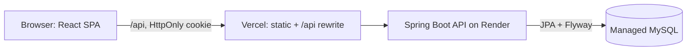
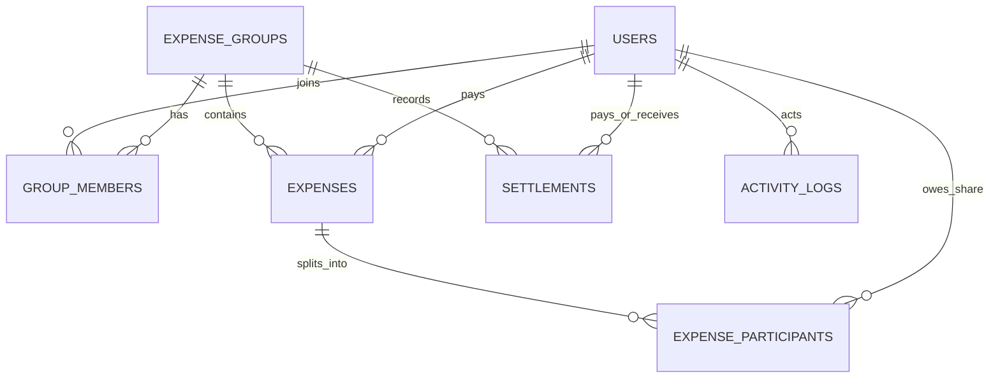

# SplitEase

> Split bills. Share fairly. Stay friends.

A full-stack expense-sharing and settlement app: React + TypeScript frontend, Spring Boot 3 / Java 21 backend, MySQL with Flyway migrations.

**Live URLs:** not deployed yet. See [docs/DEPLOYMENT.md](docs/DEPLOYMENT.md). Once deployed, add the frontend URL, API URL and `/swagger-ui.html` here.

## Problem
When several people share costs, working out who paid, who owes, and the fewest repayments gets confusing. SplitEase keeps one record, derives balances from it, suggests minimal settlements, and tracks confirmed payments.

## Features
Registration/login (BCrypt, JWT in HttpOnly cookie), onboarding, groups (Trip/Home/College/Couple/Other, per-group currency), members by registered email, expenses with four split methods, edit/delete with automatic balance recalculation, suggested settlements, settlement lifecycle (pending → confirmed/rejected), transaction search/filter/pagination, analytics (monthly, category, group), activity audit log, profile/password settings, admin dashboard (stats, suspend/reactivate users).

## Stack
React 18, TypeScript, Vite, Tailwind, React Router, Axios, React Hook Form + Zod, Recharts, Lucide · Java 21, Spring Boot 3.3, Spring Security, Spring Data JPA, Bean Validation, Actuator, springdoc OpenAPI, jjwt · MySQL 8 + Flyway · JUnit 5, Mockito/Spring Boot Test, Vitest + Testing Library.

## Architecture

Layers: `Controller → Service → Repository → DB`. DTOs everywhere (entities never leave the service layer). Money logic lives in three framework-free classes: `SplitCalculator`, `BalanceEngine`, `SettlementOptimizer`.

## ER diagram

Design choices: money is `DECIMAL(19,2)`; **balances are never stored**, they are computed from active expenses and confirmed settlements; expenses are soft-deleted to preserve history; unique `(group_id,user_id)` and `(expense_id,user_id)`; CHECK constraints for positive amounts and payer ≠ receiver. Session revocation uses `users.token_version` (bumped on password change or suspension) instead of a refresh-token table.

## Algorithms
**Splitting** (`SplitCalculator`): work in cents with `BigDecimal`. Each participant gets `floor(total × weight / Σweight)`; the leftover cents go one each to the largest fractional remainders, ties broken by lowest user id. Shares therefore always sum exactly to the total and the result is deterministic. Equal = weight 1; percentage must total 100; shares use units; exact must sum to the total.

**Balance**: `net = paid − allocated shares + confirmed settlements paid − confirmed settlements received`. Positive = should receive.

**Settlement optimization** (`SettlementOptimizer`): split members into debtors and creditors, sort each by amount (desc, then id), repeatedly transfer `min(debt, credit)` between the heads. At most n−1 transfers; totals preserved. Output is a *suggestion*. SplitEase never moves money.

**Settlement rules**: payer must owe ≥ amount and receiver be owed ≥ amount (confirmed balances); only the receiver (or a group admin who isn't the payer) confirms; confirmation takes a row lock (`PESSIMISTIC_WRITE`), so a duplicate confirm gets 409; pending settlements never affect balances.

## Authentication & security
JWT (HS256) in an HttpOnly, Secure cookie; Bearer header also accepted for Swagger/Postman. State-changing cookie requests need `X-Requested-With` (CSRF guard). CORS uses explicit origins with credentials. Non-members get 404 on group resources (no ID probing). Login errors are uniform. Rate limit on login/register (in-memory, per IP). BCrypt hashing. Secrets only via environment. Admin routes gated by URL rule and `@PreAuthorize`. First admin comes from `ADMIN_EMAIL`/`ADMIN_PASSWORD` env vars.

## Run locally
```bash
cp .env.example .env          # fill the dummy values
docker compose up --build     # app on :3000, API on :8080, Swagger on :8080/swagger-ui.html
```
Without Docker: start MySQL, then
```bash
cd backend && JWT_SECRET=$(openssl rand -base64 48) DB_PASSWORD=... SPRING_PROFILES_ACTIVE=dev DEMO_PASSWORD='...' mvn spring-boot:run
cd frontend && npm install && npm run dev      # http://localhost:5173
```
The `dev` profile seeds Alice, Bob and Charlie (`*@demo.splitease.local`) with the ₹900 dinner / ₹600 groceries scenario and a confirmed ₹400 settlement. Never use it in production.

## Environment variables
| Variable | Purpose |
|---|---|
| `DB_URL`, `DB_USERNAME`, `DB_PASSWORD` | MySQL connection |
| `JWT_SECRET` | ≥32 chars, required |
| `CORS_ALLOWED_ORIGINS` | comma-separated frontend origins |
| `COOKIE_SECURE`, `COOKIE_SAMESITE` | cookie flags (`true`/`Lax` or `None`) |
| `ADMIN_EMAIL`, `ADMIN_PASSWORD`, `ADMIN_NAME` | optional first-admin bootstrap |
| `AUTH_RATE_LIMIT_PER_MINUTE` | default 10 |
| `VITE_API_URL` (frontend) | API base URL; empty when using the Vercel rewrite |

## Migrations
Flyway runs automatically at startup (`backend/src/main/resources/db/migration`). Add `V2__...sql` files for schema changes; never edit applied ones.

## API (all under `/api`; full docs at `/swagger-ui.html`)
Auth: `POST /auth/register|login|logout` · Users: `GET|PUT /users/me`, `POST /users/me/onboarding`, `POST /users/me/password` · `GET /dashboard` · Groups: `POST|GET /groups`, `GET|PUT /groups/{id}`, `POST /groups/{id}/members`, `POST /groups/{id}/leave`, `GET /groups/{id}/balances`, `GET /groups/{id}/settlement-suggestions` · Expenses: `POST|GET /groups/{id}/expenses`, `GET|PUT|DELETE /expenses/{id}` · Settlements: `POST|GET /groups/{id}/settlements`, `GET /settlements`, `POST /settlements/{id}/confirm|reject` · `GET /transactions` (q, from, to, category, groupId, type, page, size) · Analytics: `GET /analytics/overview|monthly|categories|groups` · `GET /activity` · Admin: `GET /admin/stats|users`, `PUT /admin/users/{id}/status`.
Errors share one shape: `{timestamp,status,error,message,fieldErrors?}`.

## Testing
```bash
cd frontend && npm test                       # Vitest: 11 tests
cd backend && mvn test                        # JUnit unit tests + SplitEaseFlowIT integration test (H2, MySQL mode)
```
Dependency-free engine check (no Maven needed):
```bash
cd backend/src/main/java && javac -d /tmp/out com/splitease/expense/*.java com/splitease/balance/*.java com/splitease/settlement/SettlementOptimizer.java ../../../tools/CoreCheck.java && java -cp /tmp/out CoreCheck
```

### What was actually run when this project was generated
| Check | Result |
|---|---|
| Split/balance/settlement engine harness (15 assertions incl. ₹900/₹600 scenario) | passed |
| Frontend `tsc`, production build, Vitest (11 tests) | passed |
| Backend Spring layer, JUnit tests, `SplitEaseFlowIT` | **written, not compiled or run** (the build sandbox couldn't reach Maven Central). Run `mvn test` first and fix anything it reports. |
| Deployment | **not done** |

## How this demonstrates…
OOP: small cohesive classes, records, enums, dependency injection. REST: resource URLs, status codes, DTOs, pagination, one error format. SQL: normalised schema, FKs, unique/check constraints, indexes, Flyway. Auth: BCrypt, JWT cookies, role + membership authorization, IDOR protection. Financial correctness: BigDecimal, cents-based allocation, derived balances. Consistency: `@Transactional` multi-row writes, row-lock on confirmation, audit log in the same transaction. Testing: pure unit tests plus full-stack integration tests. Cloud: Docker, Render, Vercel, managed MySQL.

## Known limitations
- No FX conversion: dashboard/analytics only total groups in your preferred currency.
- Members must already have an account (no email invitations).
- Rate limiter is in-memory (single instance).
- Analytics aggregate in Java, fine for friend-group scale, not tuned or load-tested.
- Settlement amounts are validated against net balances, so settling pairwise beyond the optimized net isn't allowed.
- No real payment gateway; UPI/bank/cash are records only.
- Logout clears the cookie; a stolen token stays valid until expiry (2 h) unless the password changes or the account is suspended.
